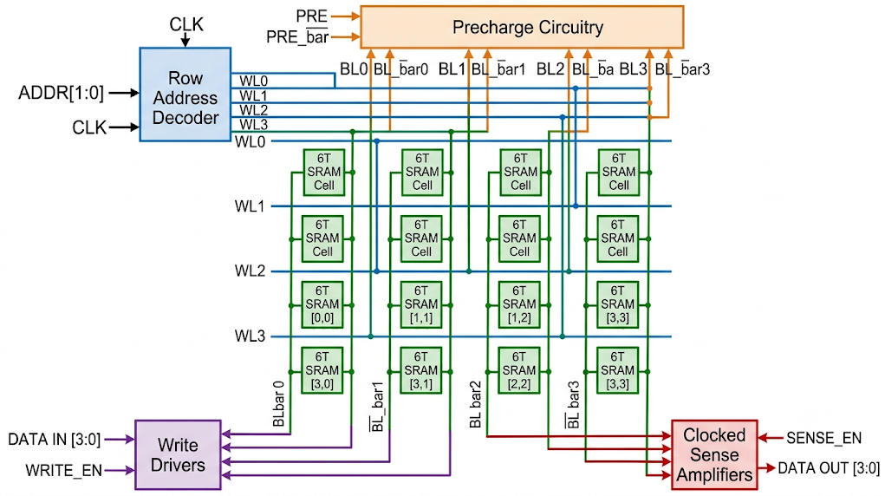
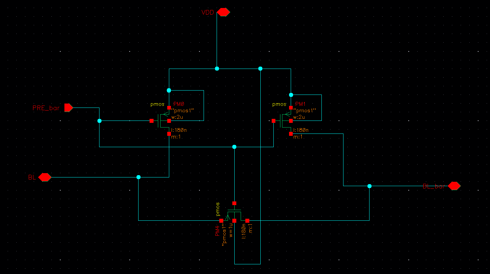
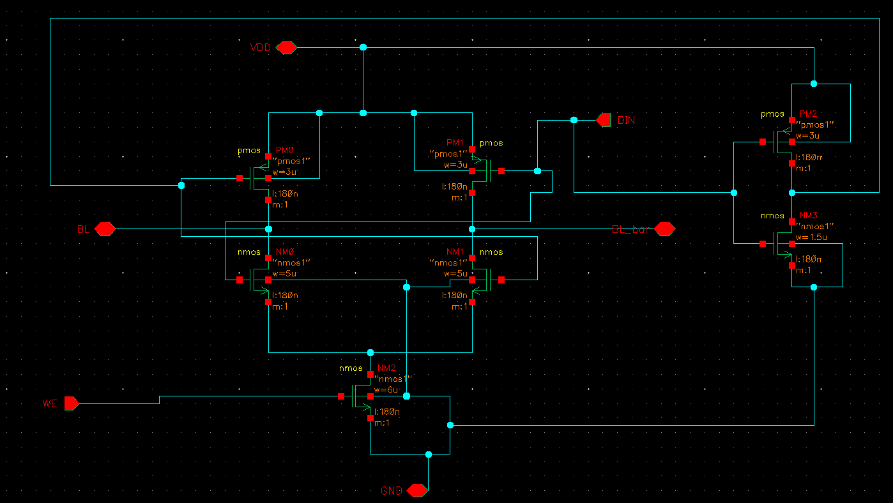
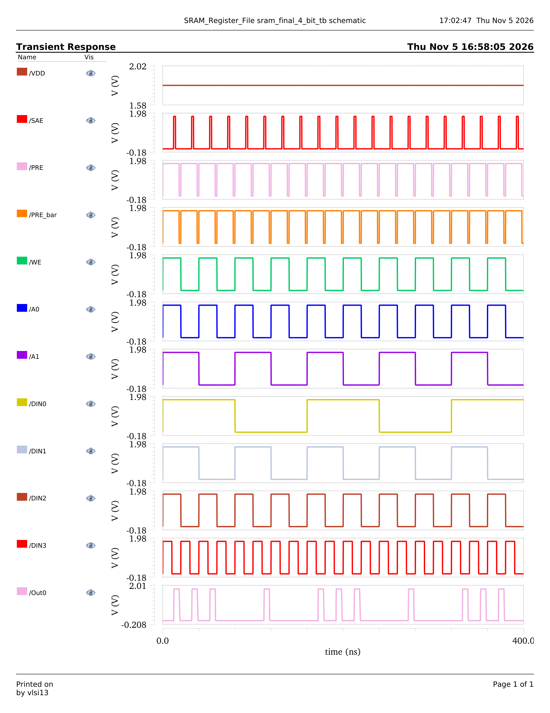
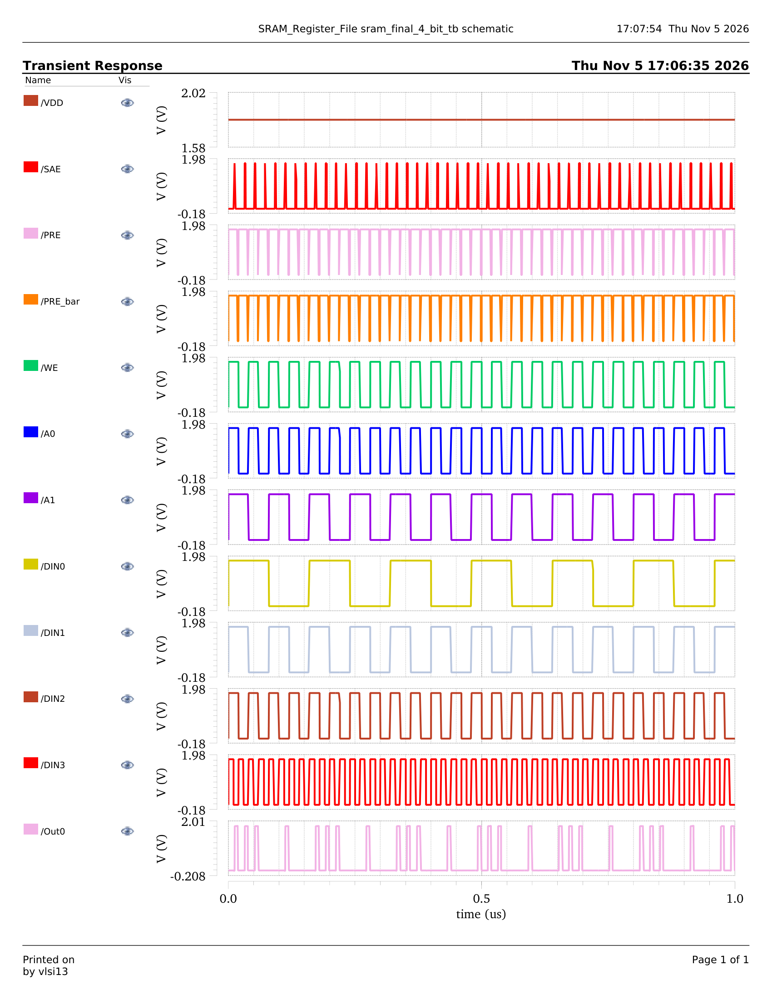
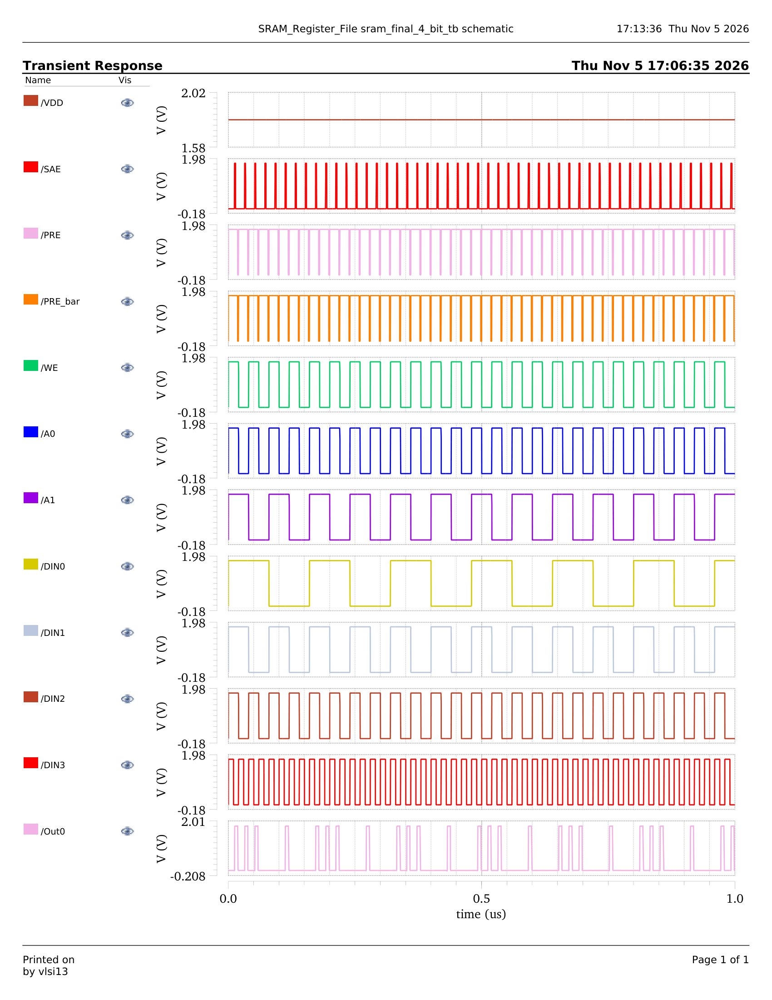

# 4-Word x 4-Bit Synchronous SRAM Register File with Differential Sense Amplifiers

[](https://www.cadence.com)
[](https://www.cadence.com)
[]()
[-blueviolet.svg)]()
[-success.svg)]()
[]()
[]()
[-brightgreen.svg)]()

A high-performance, fully custom **4-Word x 4-Bit (16-Bit) Synchronous Static Random-Access Memory (SRAM) Register File** designed and physically implemented in **Cadence Virtuoso IC6.1.x** using the **Generic 180nm CMOS Process Design Kit (gpdk180)** operating at a nominal supply voltage of **$V_{DD} = 1.8\text{ V}$**. 

The design incorporates balanced 6-Transistor (6T) SRAM bitcells, a low-latency 2-to-4 row address decoder, high-drive tri-state write drivers, a bitline precharge/equalization network, and fast regenerative differential latch-type sense amplifiers to achieve low read latency, high noise immunity, and energy-efficient memory operations. The full custom layout is signed off with **Assura DRC (Design Rule Checking)**, **Assura LVS (Layout Versus Schematic)** matching with 100% equivalence, and **Assura RCX / QRC Parasitic RC Extraction** generating clean `av_extracted` post-layout views.

---

## Table of Contents
1. [Project Highlights & Key Specifications](#project-highlights--key-specifications)
2. [Transistor Count & Component Breakdown](#transistor-count--component-breakdown)
3. [Architectural Overview & System Block Diagram](#architectural-overview--system-block-diagram)
4. [Theory of Operation & Timing Cycle](#theory-of-operation--timing-cycle)
   - [Phase 1: Precharge & Bitline Equalization](#phase-1-precharge--bitline-equalization)
   - [Phase 2: Synchronous Write Operation](#phase-2-synchronous-write-operation)
   - [Phase 3: Synchronous Read Operation](#phase-3-synchronous-read-operation)
   - [Phase 4: Differential Sense Amplification](#phase-4-differential-sense-amplification)
   - [Stability Criteria & Sizing Margins](#stability-criteria--sizing-margins)
5. [Hierarchical Cell-by-Cell Design, Simulation & Layout](#hierarchical-cell-by-cell-design-simulation--layout)
   - [1. CMOS Inverter (NOT Gate)](#1-cmos-inverter-not-gate)
   - [2. 2-Input CMOS NOR Gate](#2-2-input-cmos-nor-gate)
   - [3. 2-to-4 Row Address Decoder](#3-2-to-4-row-address-decoder)
   - [4. Standard 6T SRAM Bitcell](#4-standard-6t-sram-bitcell)
   - [5. Bitline Precharge & Equalization Unit](#5-bitline-precharge--equalization-unit)
   - [6. High-Drive Write Driver Circuit](#6-high-drive-write-driver-circuit)
   - [7. Latch-Based Differential Sense Amplifier](#7-latch-based-differential-sense-amplifier)
   - [8. 4-Word x 1-Bit SRAM Core Column Array](#8-4-word--1-bit-sram-core-column-array)
   - [9. Top-Level 4-Word x 4-Bit Synchronous SRAM Macro](#9-top-level-4-word--4-bit-synchronous-sram-macro)
6. [Top-Level Full-Chip Verification & Waveform Analysis](#top-level-full-chip-verification--waveform-analysis)
7. [Physical Design & Sign-Off Verification (DRC, LVS, PEX)](#physical-design--sign-off-verification-drc-lvs-pex)
8. [Repository File Hierarchy](#repository-file-hierarchy)
9. [Cadence Virtuoso Simulation & Replication Guide](#cadence-virtuoso-simulation--replication-guide)
10. [Acknowledgements](#acknowledgements)
11. [Author Information](#author-information)

---

## Project Highlights & Key Specifications

| Parameter | Specification / Value |
| :--- | :--- |
| **Technology Node** | Cadence GPDK 180nm CMOS (gpdk180) |
| **Nominal Power Supply ($V_{DD}$)** | $1.8\text{ V}$ |
| **Total Memory Capacity** | 16 Bits (4 Words x 4 Bits/Word) |
| **Word Organization** | 4 Addressable Words (Word 0 to Word 3) |
| **Data Word Width** | 4-Bit Parallel I/O ($DIN[3:0]$, $DOUT[3:0]$) |
| **Address Bus Width** | 2-Bit Binary Decoded ($A_0, A_1$) |
| **Total Transistor Count** | **208 Transistors** |
| **Total NMOS Count** | **114 NMOS** |
| **Total PMOS Count** | **94 PMOS** |
| **Memory Cell Topology** | Symmetric 6-Transistor (6T) CMOS Static RAM Cell |
| **Address Decoder** | 2-to-4 Static CMOS Decoder with complementary NOR/Inverter stages |
| **Bitline Conditioning** | Active-low PMOS Pull-Up Precharge and Cross-Bitline Equalization |
| **Write Circuitry** | Full-swing Push-Pull Tri-state Write Drivers |
| **Read Sensing Mechanism** | Strobe-Activated Differential Regenerative Latch Sense Amplifier |
| **Physical Sign-Off: DRC** | **Clean (0 Errors / 0 Violations)** via Assura DRC |
| **Physical Sign-Off: LVS** | **100% Schematic-to-Layout Match (0 Net/Instance Discrepancies)** |
| **Parasitic Extraction** | **Assura RCX / QRC Parasitic RC Extraction (`av_extracted` view)** |

---

## Transistor Count & Component Breakdown

The complete 4-Word x 4-Bit SRAM Register File macro integrates **29 sub-blocks** consisting of exactly **208 MOSFETs** (114 NMOS and 94 PMOS transistors):

| Subsystem / Functional Block | Instances in Macro | NMOS / Unit | PMOS / Unit | Total / Unit | Cumulative NMOS | Cumulative PMOS | Cumulative Transistors |
| :--- | :---: | :---: | :---: | :---: | :---: | :---: | :---: |
| **2-to-4 Row Address Decoder** | 1 | 10 | 10 | 20 | 10 | 10 | 20 |
| **6T SRAM Bitcell** | 16 | 4 | 2 | 6 | 64 | 32 | 96 |
| **Bitline Precharge Unit** | 4 | 0 | 5 | 5 | 0 | 20 | 20 |
| **Write Driver Circuit** | 4 | 4 | 3 | 7 | 16 | 12 | 28 |
| **Differential Sense Amplifier** | 4 | 6 | 5 | 11 | 24 | 20 | 44 |
| **FULL-CHIP SRAM MACRO** | **29 Blocks** | — | — | — | **114 NMOS** | **94 PMOS** | **208 Transistors** |

* **NMOS Contribution**: $10\text{ (Decoder)} + 64\text{ (Core Array)} + 0\text{ (Precharge)} + 16\text{ (Write Drivers)} + 24\text{ (Sense Amps)} = 114\text{ NMOS}$ (54.8%)
* **PMOS Contribution**: $10\text{ (Decoder)} + 32\text{ (Core Array)} + 20\text{ (Precharge)} + 12\text{ (Write Drivers)} + 20\text{ (Sense Amps)} = 94\text{ PMOS}$ (45.2%)

---

## Architectural Overview & System Block Diagram

The synchronous SRAM register file is structured into a modular, column-and-row regular matrix. A 2-bit binary address bus ($A_0, A_1$) drives the **2-to-4 Row Address Decoder**, which selectively raises one of four mutually exclusive wordlines ($WL_0, WL_1, WL_2, WL_3$). 

Each column represents one bit of the 4-bit data word and consists of:
1. **Precharge & Equalization Unit**: Pulls both differential bitlines ($BL_j, \overline{BL_j}$) to $V_{DD}$ prior to evaluation and balances their initial voltages.
2. **6T SRAM Bitcell Column**: Four vertically stacked 6T cells sharing the same bitline pair.
3. **Write Driver**: Translates input data $DIN_j$ into complementary rail-to-rail signals on $(BL_j, \overline{BL_j})$ during write cycles ($WE = 1$).
4. **Differential Latch Sense Amplifier**: Detects small differential discharge on $(BL_j, \overline{BL_j})$ during read cycles, rapidly resolving it to a digital logic level at $DOUT_j$ when strobed by $SAE$.

### System Architecture Diagram

[](SRAM_Register_File)

> 📂 **Design Library Source**: [Explore Cadence Design Library (`SRAM_Register_File`)](SRAM_Register_File)

---

## Theory of Operation & Timing Cycle

The SRAM operation is segmented into synchronous non-overlapping phases governed by the precharge clock ($\overline{PRE}$), write enable ($WE$), address bus ($A_0, A_1$), and sense amplifier enable ($SAE$).

```
Timing Sequence:
Clock / PRE_bar:  ___/\______/\______/\______/\______
Wordline (WL):    ______/\___________/\___________
Write Enable (WE):______/\_________________________ (Write Cycle)
SAE (Sense Strobe):___________________/\___________ (Read Cycle)
Bitlines:         =====[ Precharge ]==[ Differential ]==
```

### Phase 1: Precharge & Bitline Equalization
* **Conditions**: $\overline{PRE} = 0\text{ V}$ (active LOW), $WL_i = 0\text{ V}$, $WE = 0\text{ V}$, $SAE = 0\text{ V}$.
* **Mechanism**: The precharge unit turns ON two pull-up PMOS transistors and one equalization PMOS transistor across each bitline pair.
* Both $BL$ and $\overline{BL}$ are charged solidly to $V_{DD} = 1.8\text{ V}$.
* The equalization transistor shorts $BL$ and $\overline{BL}$, eliminating any residual differential voltage ($\Delta V_{BL} = 0\text{ V}$) from prior operations, establishing symmetric initial states.

### Phase 2: Synchronous Write Operation
* **Conditions**: $\overline{PRE} = 1.8\text{ V}$ (OFF), $WE = 1.8\text{ V}$ (active HIGH), $WL_k = 1.8\text{ V}$ (selected by $A_0, A_1$), $SAE = 0\text{ V}$.
* **Mechanism**: 
  1. The write driver receives single-ended input data $DIN$. It forcefully drives one bitline to solid ground ($0\text{ V}$) and holds the complementary bitline at $V_{DD}$ ($1.8\text{ V}$).
  2. The row decoder asserts the targeted wordline $WL_k$, turning ON the access NMOS transistors of all four bitcells in that row.
  3. The bitline pulled to ground discharges the internal node storing "1" through the access transistor. Because the access transistor is sized stronger than the internal PMOS pull-up load transistor (satisfying the **Pull-up Ratio / Writeability condition**), the internal node drops below the switching threshold ($V_M$) of the inverter, causing the regenerative latch to flip instantaneously.

### Phase 3: Synchronous Read Operation
* **Conditions**: $\overline{PRE} = 1.8\text{ V}$ (OFF), $WE = 0\text{ V}$ (write drivers tri-stated/isolated), $WL_k = 1.8\text{ V}$ (selected row), $SAE = 0\text{ V} \to 1.8\text{ V}$.
* **Mechanism**:
  1. With bitlines precharged to $V_{DD}$ and floating, $WL_k$ is pulsed HIGH.
  2. The access transistors connect the internal storage nodes ($Q$ and $\overline{Q}$) to $BL$ and $\overline{BL}$.
  3. The storage node at "0" draws current through its pull-down driver NMOS and access NMOS, gradually discharging that bitline:
     $$\Delta V_{BL}(t) = \frac{I_{read} \cdot \Delta t}{C_{BL}}$$
  4. The opposite bitline remains tied to the node at "1" and stays at $V_{DD}$.
  5. Sizing constraints ensure that the voltage rise at the "0" node does not exceed the threshold voltage ($V_{tn}$) of the companion NMOS pull-down, preserving **Read Stability**.

### Phase 4: Differential Sense Amplification
* Once a small, reliable differential voltage ($\Delta V_{BL} \approx 100\text{ mV} - 200\text{ mV}$) is established across the bitline pair, the strobe signal **$SAE$** is driven HIGH.
* The differential latch sense amplifier activates its cross-coupled inverter pair through an NMOS tail transistor.
* The regenerative positive feedback of the latch rapidly magnifies the small differential analog signal to full rail-to-rail digital logic levels ($0\text{ V}$ / $1.8\text{ V}$) at $DOUT$.
* **Power Advantage**: The memory does not need to discharge the heavy bitline capacitance all the way to ground during reads. Sensing at $\Delta V_{BL} \ll V_{DD}$ saves substantial dynamic active power ($P_{dyn} = C_{BL} \cdot V_{DD} \cdot \Delta V \cdot f$).

### Stability Criteria & Sizing Margins

The robust operation of the 6T SRAM cell relies on two critical transistor sizing ratios:

$$\text{Cell Ratio } (\beta) = \frac{(W/L)_{driver}}{(W/L)_{access}} = \frac{(W/L)_{M1,M2}}{(W/L)_{M5,M6}} \ge 1.5 - 2.0 \quad \text{[Guarantees Read Stability]}$$

$$\text{Pull-up Ratio } (\gamma) = \frac{(W/L)_{load}}{(W/L)_{access}} = \frac{(W/L)_{M3,M4}}{(W/L)_{M5,M6}} < 1.0 \quad \text{[Guarantees Writeability]}$$

---

## Hierarchical Cell-by-Cell Design, Simulation & Layout

Following the structured bottom-up custom IC design methodology, each sub-block is presented in strict hierarchical sequence: **Circuit Theory & Sizing**, **Schematic Diagram**, **Testbench Circuit**, **Simulation Waveforms**, and **Physical Layout Design** (both dark-background and white-background views), concluding with physical sign-off verification. 

Every image is clickable to navigate directly into its original design cellview folder in `SRAM_Register_File/`.

---

### 1. CMOS Inverter (NOT Gate)

#### Circuit Theory & Design
The static CMOS inverter serves as the elemental building block for memory latches, address complementary line generation, and write driver logic. 
* **Transistor Count**: 2 Transistors (1 NMOS, 1 PMOS).
* Designed in GPDK 180nm with balanced PMOS-to-NMOS width ratio ($W_p/W_n \approx 2.0 - 2.5$) to compensate for the hole mobility deficit ($\mu_n / \mu_p \approx 2.5$), ensuring symmetrical rise/fall propagation delays ($t_{pLH} = t_{pHL}$) and a midpoint switching threshold $V_M \approx V_{DD}/2 = 0.9\text{ V}$.

#### Schematic Diagram
The transistor-level schematic features PMOS connected between $V_{DD}$ and Output, and NMOS between Output and $GND$, sharing a common gate input.

[](SRAM_Register_File/inverter/schematic)

> 📂 **Design Original Folder**: [Open Inverter Schematic View (`SRAM_Register_File/inverter/schematic`)](SRAM_Register_File/inverter/schematic)

#### Testbench Setup
Transient pulse stimuli applied with rise/fall times of $50\text{ ps}$ and $1.8\text{ V}$ amplitude to evaluate transfer curves, noise margins, and propagation delay.

[](SRAM_Register_File/inverter_tb)

> 📂 **Design Original Folder**: [Open Inverter Testbench View (`SRAM_Register_File/inverter_tb`)](SRAM_Register_File/inverter_tb)

#### Simulation Output
Full rail-to-rail swing ($0\text{ V}$ to $1.8\text{ V}$) with sharp switching characteristics and sub-nanosecond delay.

[](SRAM_Register_File/inverter)

> 📂 **Design Original Folder**: [Open Inverter Cell Directory (`SRAM_Register_File/inverter`)](SRAM_Register_File/inverter)

#### Physical Layout Design
Custom layout with matched poly routing, guard rings, $N$-well substrate taps, and minimum parasitic area.

##### Physical Layout (Standard Dark Background)
[](SRAM_Register_File/inverter/layout)

##### Physical Layout (White Background View)
[](SRAM_Register_File/inverter/layout)

> 📂 **Design Original Folder**: [Open Inverter Layout View (`SRAM_Register_File/inverter/layout`)](SRAM_Register_File/inverter/layout)

* **Sign-Off Status**: Assura DRC Clean (0 errors), Assura LVS 100% matched, Parasitic RC Extracted.

---

### 2. 2-Input CMOS NOR Gate

#### Circuit Theory & Design
The 2-input NOR gate ($Y = \overline{A + B}$) forms the fundamental decoding gate in the 2-to-4 row address decoder.
* **Transistor Count**: 4 Transistors (2 NMOS, 2 PMOS).
* **Pull-Up Network**: Two series-connected PMOS devices. To compensate for the doubled series channel on-resistance ($R_{p,eq} = 2 \cdot R_p$), the PMOS widths are upscaled ($W_p \ge 4 \cdot W_n$) to maintain balanced rise times.
* **Pull-Down Network**: Two parallel NMOS devices offering low discharge resistance to ground.

#### Schematic Diagram
Transistor implementation showing series PMOS pull-up and parallel NMOS pull-down branches.

[](SRAM_Register_File/2_input_NOR/schematic)

> 📂 **Design Original Folder**: [Open 2-Input NOR Schematic View (`SRAM_Register_File/2_input_NOR/schematic`)](SRAM_Register_File/2_input_NOR/schematic)

#### Testbench Setup
Exhaustive 2-bit digital sequence applied across inputs $A$ and $B$ (00, 01, 10, 11) to verify truth table compliance.

[](SRAM_Register_File/2_input_NOR_tb)

> 📂 **Design Original Folder**: [Open 2-Input NOR Testbench View (`SRAM_Register_File/2_input_NOR_tb`)](SRAM_Register_File/2_input_NOR_tb)

#### Simulation Output
Clean transient verification showing output HIGH ($1.8\text{ V}$) strictly when $A=0$ and $B=0$, and LOW ($0\text{ V}$) for all other input combinations.

[](SRAM_Register_File/2_input_NOR)

> 📂 **Design Original Folder**: [Open 2-Input NOR Cell Directory (`SRAM_Register_File/2_input_NOR`)](SRAM_Register_File/2_input_NOR)

#### Physical Layout Design
Symmetric poly gates, compact active diffusion sharing to minimize drain junction capacitance, and continuous power rails.

##### Physical Layout (Standard Dark Background)
[](SRAM_Register_File/2_input_NOR/layout)

##### Physical Layout (White Background View)
[](SRAM_Register_File/2_input_NOR/layout)

> 📂 **Design Original Folder**: [Open 2-Input NOR Layout View (`SRAM_Register_File/2_input_NOR/layout`)](SRAM_Register_File/2_input_NOR/layout)

* **Sign-Off Status**: Assura DRC Clean (0 errors), Assura LVS 100% matched, Parasitic RC Extracted.

---

### 3. 2-to-4 Row Address Decoder

#### Circuit Theory & Design
The row address decoder converts the 2-bit binary memory address ($A_0, A_1$) into four one-hot active-HIGH wordline signals ($WL_0, WL_1, WL_2, WL_3$).
* **Transistor Count**: 20 Transistors (10 NMOS, 10 PMOS).
* Constructed using 2 CMOS inverters to generate internal complementary signals ($\overline{A_0}, \overline{A_1}$) and 4 NOR gates configured to implement:
  - $WL_0 = \overline{A_1 + A_0} = \overline{A_1} \cdot \overline{A_0} \implies \text{Word 0}$
  - $WL_1 = \overline{A_1 + \overline{A_0}} = \overline{A_1} \cdot A_0 \implies \text{Word 1}$
  - $WL_2 = \overline{\overline{A_1} + A_0} = A_1 \cdot \overline{A_0} \implies \text{Word 2}$
  - $WL_3 = \overline{\overline{A_1} + \overline{A_0}} = A_1 \cdot A_0 \implies \text{Word 3}$
* Mutual exclusivity is maintained across all timing corners, preventing multi-wordline activation and bus contention.

#### Schematic Diagram
Schematic showing address inverter buffers driving the four NOR decoding gates.

[](SRAM_Register_File/row_decoder_2to4/schematic)

> 📂 **Design Original Folder**: [Open Row Decoder Schematic View (`SRAM_Register_File/row_decoder_2to4/schematic`)](SRAM_Register_File/row_decoder_2to4/schematic)

#### Testbench Setup
Binary address sweep from $00_2$ to $11_2$ with synchronous transition edges.

[](SRAM_Register_File/row_decoder_2to4_tb)

> 📂 **Design Original Folder**: [Open Row Decoder Testbench View (`SRAM_Register_File/row_decoder_2to4_tb`)](SRAM_Register_File/row_decoder_2to4_tb)

#### Simulation Output
Waveforms confirm exact 1-of-4 decoding with fast propagation delay from address change to wordline transition.

[](SRAM_Register_File/row_decoder_2to4)

> 📂 **Design Original Folder**: [Open Row Decoder Cell Directory (`SRAM_Register_File/row_decoder_2to4`)](SRAM_Register_File/row_decoder_2to4)

#### Physical Layout Design
Pitch-matched layout aligned with the row pitch of the SRAM core matrix to ensure direct horizontal wordline routing in Metal2/Metal3 without dogleg detours.

##### Physical Layout (Standard Dark Background)
[](SRAM_Register_File/row_decoder_2to4/layout)

##### Physical Layout (White Background View)
[](SRAM_Register_File/row_decoder_2to4/layout)

> 📂 **Design Original Folder**: [Open Row Decoder Layout View (`SRAM_Register_File/row_decoder_2to4/layout`)](SRAM_Register_File/row_decoder_2to4/layout)

* **Sign-Off Status**: Assura DRC Clean (0 errors), Assura LVS 100% matched, Parasitic RC Extracted.

---

### 4. Standard 6T SRAM Bitcell

#### Circuit Theory & Design
The standard 6-Transistor static RAM cell comprises two cross-coupled CMOS inverters ($M_1-M_4$) and two NMOS pass-transistor access gates ($M_5, M_6$).
* **Transistor Count**: 6 Transistors (4 NMOS, 2 PMOS).
* **Read Stability**: Designed with Cell Ratio $\beta = (W/L)_{M1,M2} / (W/L)_{M5,M6} \approx 1.8$, preventing the read current from elevating node voltage $V_Q$ above the NMOS threshold voltage $V_{tn}$.
* **Writeability**: Designed with Pull-Up Ratio $\gamma = (W/L)_{M3,M4} / (W/L)_{M5,M6} \approx 0.6 < 1.0$, allowing the write driver to pull down the node storing "1" past $V_M$ to guarantee write success.
* **Storage Nodes**: Symmetrical bistable state storage ($Q$ and $\overline{Q}$).

#### Schematic Diagram
Complete transistor schematic showing the cross-coupled inverter core and wordline-gated access transistors.

[](SRAM_Register_File/sram_cell_6t/schematic)

> 📂 **Design Original Folder**: [Open 6T SRAM Cell Schematic View (`SRAM_Register_File/sram_cell_6t/schematic`)](SRAM_Register_File/sram_cell_6t/schematic)

#### Testbench Circuit Setups
Multiple testbenches were constructed to verify: (1) Transient hold and read stability, (2) Multi-cycle read and write operations, and (3) Read discharge behavior under bitline load.

##### Static & Transient Testbench
[](SRAM_Register_File/sram_cell_tb)

##### Read & Write Operation Testbench
[](SRAM_Register_File/sram_cell_tb)

##### Read Operation Loaded Circuit
[](SRAM_Register_File/sram_cell_tb)

> 📂 **Design Original Folder**: [Open 6T SRAM Cell Testbench View (`SRAM_Register_File/sram_cell_tb`)](SRAM_Register_File/sram_cell_tb)

#### Simulation Outputs
* **Dynamic Read & Write Cycles**: Demonstrating successful non-destructive read operations and state flipping during writes.
* **Transient Stability**: Preserving stored data indefinitely in hold mode with zero static gate leakage dissipation.

##### Transient 6T Cell Response Waveform
[](SRAM_Register_File/sram_cell_6t)

##### Read and Write Operation Dynamic Waveforms
[](SRAM_Register_File/sram_cell_6t)

> 📂 **Design Original Folder**: [Open 6T SRAM Cell Directory (`SRAM_Register_File/sram_cell_6t`)](SRAM_Register_File/sram_cell_6t)

#### Physical Layout Design
Highly optimized symmetrical layout featuring thin-cell topology, shared contact diffusion for $V_{DD}$ and $GND$, and vertical bitline / horizontal wordline routing tracks.

##### Physical Layout (Standard Dark Background)
[](SRAM_Register_File/sram_cell_6t/layout)

##### Physical Layout (White Background View)
[](SRAM_Register_File/sram_cell_6t/layout)

> 📂 **Design Original Folder**: [Open 6T SRAM Cell Layout View (`SRAM_Register_File/sram_cell_6t/layout`)](SRAM_Register_File/sram_cell_6t/layout)

* **Sign-Off Status**: Assura DRC Clean (0 errors), Assura LVS 100% matched, Parasitic RC Extracted.

---

### 5. Bitline Precharge & Equalization Unit

#### Circuit Theory & Design
The precharge and equalization circuit prepares the high-capacitance bitline pairs for upcoming read and write operations.
* **Transistor Count**: 5 Transistors (0 NMOS, 5 PMOS).
* Contains dual pull-up PMOS transistors connected between $V_{DD}$ and the bitlines, plus one bridging PMOS equalization transistor connected between $BL$ and $\overline{BL}$.
* Controlled by active-low signal $\overline{PRE}$:
  - When $\overline{PRE} = 0\text{ V}$, both bitlines are pulled up to $V_{DD}$ and equalized to eliminate residual voltage offsets.
  - When $\overline{PRE} = 1.8\text{ V}$, the circuit turns OFF completely, allowing bitlines to float during read differential discharge or be pulled down by write drivers without DC supply contention.

#### Schematic Diagram
Five-transistor PMOS network providing simultaneous pull-up and cross-equalization.

[](SRAM_Register_File/precharge_unit/schematic)

> 📂 **Design Original Folder**: [Open Precharge Unit Schematic View (`SRAM_Register_File/precharge_unit/schematic`)](SRAM_Register_File/precharge_unit/schematic)

#### Testbench Setup
Testbench evaluating precharge recovery time and equalization speed across loaded bitlines.

[](SRAM_Register_File/precharge_tb)

> 📂 **Design Original Folder**: [Open Precharge Testbench View (`SRAM_Register_File/precharge_tb`)](SRAM_Register_File/precharge_tb)

#### Simulation Outputs
* Rapid bitline pull-up recovery from $0\text{ V}$ to $1.8\text{ V}$ within hundreds of picoseconds.
* Full integration waveforms showing periodic precharge assertion between read access events.

##### Standalone Precharge Characteristic Response
[](SRAM_Register_File/precharge_unit)

##### Read Operation Circuit with 6T Cell & Precharge Unit
[](SRAM_Register_File/precharge_unit)

##### Full Read Operation Waveforms with Precharge Cycling
[](SRAM_Register_File/precharge_unit)

> 📂 **Design Original Folder**: [Open Precharge Unit Cell Directory (`SRAM_Register_File/precharge_unit`)](SRAM_Register_File/precharge_unit)

#### Physical Layout Design
Pitch-matched layout placed at the top boundary of each bitline column.

##### Physical Layout (Standard Dark Background)
[](SRAM_Register_File/precharge_unit/layout)

##### Physical Layout (White Background View)
[](SRAM_Register_File/precharge_unit/layout)

> 📂 **Design Original Folder**: [Open Precharge Unit Layout View (`SRAM_Register_File/precharge_unit/layout`)](SRAM_Register_File/precharge_unit/layout)

* **Sign-Off Status**: Assura DRC Clean (0 errors), Assura LVS 100% matched, Parasitic RC Extracted.

---

### 6. High-Drive Write Driver Circuit

#### Circuit Theory & Design
The write driver overrides the stored state of the selected 6T cell by driving one bitline fully to $0\text{ V}$ while keeping the other at $V_{DD}$.
* **Transistor Count**: 7 Transistors (4 NMOS, 3 PMOS).
* Enabled by the active-HIGH **Write Enable ($WE$)** signal.
* When $WE = 1$, high-drive NMOS pull-down transistors discharge the appropriate bitline based on input data $DIN$.
* When $WE = 0$, both bitline drive paths enter high-impedance (tri-state) mode, completely isolating the write circuitry from the bitlines during read and precharge phases.

#### Schematic Diagram
Write driver schematic incorporating tri-state gating, data complementary drive, and strong pull-down transistors.

[](SRAM_Register_File/write_driver/schematic)

> 📂 **Design Original Folder**: [Open Write Driver Schematic View (`SRAM_Register_File/write_driver/schematic`)](SRAM_Register_File/write_driver/schematic)

#### Testbench Setup
Testbench applying alternating $DIN$ patterns ($0 \to 1 \to 0$) under synchronized $WE$ strobe pulses.

[](SRAM_Register_File/write_driver_tb)

> 📂 **Design Original Folder**: [Open Write Driver Testbench View (`SRAM_Register_File/write_driver_tb`)](SRAM_Register_File/write_driver_tb)

#### Simulation Output
Clear rail-to-rail complementary bitline switching when $WE$ is asserted, and high-impedance isolation when $WE$ is de-asserted.

[](SRAM_Register_File/write_driver)

> 📂 **Design Original Folder**: [Open Write Driver Cell Directory (`SRAM_Register_File/write_driver`)](SRAM_Register_File/write_driver)

#### Physical Layout Design
Compact layout featuring wide NMOS pull-down transistors for minimal ground resistance.

##### Physical Layout (Standard Dark Background)
[](SRAM_Register_File/write_driver/layout)

##### Physical Layout (White Background View)
[](SRAM_Register_File/write_driver/layout)

> 📂 **Design Original Folder**: [Open Write Driver Layout View (`SRAM_Register_File/write_driver/layout`)](SRAM_Register_File/write_driver/layout)

* **Sign-Off Status**: Assura DRC Clean (0 errors), Assura LVS 100% matched, Parasitic RC Extracted.

---

### 7. Latch-Based Differential Sense Amplifier

#### Circuit Theory & Design
The sense amplifier is a strobed differential voltage latch that amplifies small differential voltages ($\Delta V_{BL}$) on the bitlines into full CMOS logic levels.
* **Transistor Count**: 11 Transistors (6 NMOS, 5 PMOS).
* **Topology**: Cross-coupled CMOS inverter pair with NMOS tail transistors activated by **Sense Amplifier Enable ($SAE$)**.
* **High Sensitivity**: Because it uses regenerative positive feedback, once enabled, the cross-coupled pair resolves an input voltage difference as small as $50\text{ mV} - 100\text{ mV}$ within picoseconds.
* **Energy Efficiency**: Restricting the bitline swing to a small fraction of $V_{DD}$ dramatically cuts dynamic charging and discharging energy.

#### Schematic Diagram
Cross-coupled latch schematic with differential bitline inputs, strobed tail current path, and output buffers.

[](SRAM_Register_File/sense_amp/schematic)

> 📂 **Design Original Folder**: [Open Sense Amplifier Schematic View (`SRAM_Register_File/sense_amp/schematic`)](SRAM_Register_File/sense_amp/schematic)

#### Testbench Setup
Testbench applying small differential input voltages to characterize gain, strobe response time, and output settling.

[](SRAM_Register_File/sense_amp_tb)

> 📂 **Design Original Folder**: [Open Sense Amplifier Testbench View (`SRAM_Register_File/sense_amp_tb`)](SRAM_Register_File/sense_amp_tb)

#### Simulation Output
Transient waveforms showing sharp output latching to $1.8\text{ V}$ or $0\text{ V}$ immediately following the $SAE$ trigger edge.

[](SRAM_Register_File/sense_amp)

> 📂 **Design Original Folder**: [Open Sense Amplifier Cell Directory (`SRAM_Register_File/sense_amp`)](SRAM_Register_File/sense_amp)

#### Physical Layout Design
Carefully mirrored and interdigitated layout to minimize transistor mismatch and reduce input-referred DC offset voltage.

##### Physical Layout (Standard Dark Background)
[](SRAM_Register_File/sense_amp/layout)

##### Physical Layout (White Background View)
[](SRAM_Register_File/sense_amp/layout)

> 📂 **Design Original Folder**: [Open Sense Amplifier Layout View (`SRAM_Register_File/sense_amp/layout`)](SRAM_Register_File/sense_amp/layout)

* **Sign-Off Status**: Assura DRC Clean (0 errors), Assura LVS 100% matched, Parasitic RC Extracted.

---

### 8. 4-Word x 1-Bit SRAM Core Column Array

#### Circuit Theory & Design
The 4-Word x 1-Bit array forms one complete vertical slice of the memory.
* **Transistor Count**: 24 Transistors (16 NMOS, 8 PMOS) spanning four 6T SRAM cells.
* Integrates 4 stacked 6T SRAM cells along a continuous vertical differential bitline pair ($BL, \overline{BL}$).
* Connected to four independent horizontal wordlines ($WL_0, WL_1, WL_2, WL_3$).
* Verifies column-level pitch matching, continuous power rail distribution, and inter-cell parasitic capacitance.

#### Schematic Diagram
Array schematic showing 4 6T cells tied to common differential bitlines with distinct wordline controls.

[](SRAM_Register_File/sram_core_array/schematic)

> 📂 **Design Original Folder**: [Open 1-Bit Core Array Schematic View (`SRAM_Register_File/sram_core_array/schematic`)](SRAM_Register_File/sram_core_array/schematic)

#### Testbench Setup
Multi-word sequential read and write testbench verifying that activating one wordline does not disturb unselected cells sharing the same column.

[](SRAM_Register_File/sram_core_array_tb)

> 📂 **Design Original Folder**: [Open 1-Bit Core Array Testbench View (`SRAM_Register_File/sram_core_array_tb`)](SRAM_Register_File/sram_core_array_tb)

#### Simulation Output
Multi-wordline read/write verification waveforms across all 4 words.

[](SRAM_Register_File/sram_core_array)

> 📂 **Design Original Folder**: [Open 1-Bit Core Array Cell Directory (`SRAM_Register_File/sram_core_array`)](SRAM_Register_File/sram_core_array)

#### Physical Layout Design
Vertical abutment of 4 6T cells sharing continuous $V_{DD}$, $GND$, and $N$-well regions for maximum silicon area density.

##### Physical Layout (Standard Dark Background)
[](SRAM_Register_File/sram_core_array/layout)

##### Physical Layout (White Background View)
[](SRAM_Register_File/sram_core_array/layout)

> 📂 **Design Original Folder**: [Open 1-Bit Core Array Layout View (`SRAM_Register_File/sram_core_array/layout`)](SRAM_Register_File/sram_core_array/layout)

* **Sign-Off Status**: Assura DRC Clean (0 errors), Assura LVS 100% matched, Parasitic RC Extracted.

---

### 9. Top-Level 4-Word x 4-Bit Synchronous SRAM Macro

#### Circuit Theory & Design
The top-level memory macro integrates four 4-Word x 1-Bit columns with the 2-to-4 row address decoder, four precharge units, four write drivers, and four differential sense amplifiers to form the complete **16-bit Synchronous SRAM Register File**.
* **Total Transistor Count**: **208 Transistors** (114 NMOS, 94 PMOS) across 29 sub-blocks.
* Parallel 4-bit data input bus ($DIN[3:0]$) and 4-bit data output bus ($DOUT[3:0]$ / $Out[3:0]$).
* Uniform power grid distribution, clock distribution for $\overline{PRE}$ and $SAE$, and global $WE$ control.

#### Schematic Diagram
Top-level structural schematic illustrating complete integration of row decoder, 4×4 core matrix, precharge blocks, write drivers, and differential sense amplifiers.

[](SRAM_Register_File/sram_final_4_bit/schematic)

> 📂 **Design Original Folder**: [Open Top-Level SRAM Macro Schematic View (`SRAM_Register_File/sram_final_4_bit/schematic`)](SRAM_Register_File/sram_final_4_bit/schematic)

#### Testbench Setup
Comprehensive system-level testbench generating multi-cycle read and write access sequences across all four words with distinct data patterns.

[](SRAM_Register_File/sram_final_4_bit_tb)

> 📂 **Design Original Folder**: [Open Top-Level SRAM Macro Testbench View (`SRAM_Register_File/sram_final_4_bit_tb`)](SRAM_Register_File/sram_final_4_bit_tb)

#### Simulation Outputs & Multi-Cycle Waveforms
Transient simulation results over full multi-word write/read cycles:
* **Output 1**: Extended multi-cycle transient response demonstrating successive write operations to all four addresses followed by non-destructive read operations with differential sensing.
* **Output 2**: Focused verification showing exact timing correlation between address decoding, precharge de-assertion, write drive, and sense amplifier latch output.
* **Waveform Detail**: Input data ($DIN$), Address ($A_0, A_1$), and Valid Output ($DOUT$) timing alignment.

##### Full Multi-Cycle Read/Write Transient Waveform (Run 1)
[](SRAM_Register_File/sram_final_4_bit)

##### Multi-Cycle Read/Write Transient Waveform (Run 2)
[](SRAM_Register_File/sram_final_4_bit)

##### Detailed Address Bus, DIN & DOUT Timing Correlation
[](SRAM_Register_File/sram_final_4_bit)

> 📂 **Design Original Folder**: [Open Top-Level SRAM Macro Cell Directory (`SRAM_Register_File/sram_final_4_bit`)](SRAM_Register_File/sram_final_4_bit)

#### ADE ViVA Direct Simulation Reports
Direct simulation printouts from Cadence Virtuoso Analog Design Environment (ADE) ViVA waveform viewer documenting transient signal dynamics ($V_{DD} = 1.8\text{ V}$, $0\text{ to }1.0\,\mu\text{s}$):

##### ADE ViVA Simulation Waveform Report 1
[](SRAM_Register_File/sram_final_4_bit_tb)

##### ADE ViVA Simulation Waveform Report 2
[](SRAM_Register_File/sram_final_4_bit_tb)

##### ADE ViVA Simulation Waveform Report 3
[](SRAM_Register_File/sram_final_4_bit_tb)

*(Original PDF format documentation available: [`Output Report 1`](images/09_top_sram_4x4_register_file/4_bit_SRAM_Register_File_Output.pdf), [`Output Report 2`](images/09_top_sram_4x4_register_file/4_bit_SRAM_Register_File_Output_Final.pdf), [`Output Report 3`](images/09_top_sram_4x4_register_file/4_bit_SRAM_Register_File_Output_Final2.pdf))*

> 📂 **Design Original Folder**: [Open Top-Level SRAM Testbench Directory (`SRAM_Register_File/sram_final_4_bit_tb`)](SRAM_Register_File/sram_final_4_bit_tb)

#### Physical Layout Design
Full-chip monolithic custom layout integrating the row decoder on the left, four precharge units at the top, the 4×4 cell array in the center, and the four write drivers and differential sense amplifiers at the bottom.

##### Monolithic Macro Physical Layout (Wide View)
[](SRAM_Register_File/sram_final_4_bit/layout)

##### Monolithic Macro Physical Layout (Detailed Routing & Pin Views)
[](SRAM_Register_File/sram_final_4_bit/layout)

> 📂 **Design Original Folder**: [Open Top-Level Layout View (`SRAM_Register_File/sram_final_4_bit/layout`)](SRAM_Register_File/sram_final_4_bit/layout)

* **Sign-Off Status**: Assura DRC Clean (0 errors), Assura LVS 100% matched, Parasitic RC Extracted.

---

## Top-Level Full-Chip Verification & Waveform Analysis

The top-level testbench (`sram_final_4_bit_tb`) exercises the entire memory macro across an exhaustive write-then-read verification sequence across all four address locations:

### Address & Data Verification Matrix

| Cycle | Time Interval | Address ($A_1 A_0$) | Selected Word | Mode | Input Data ($DIN[3:0]$) | Control Signals Active | Output ($DOUT[3:0]$) | Result Status |
| :---: | :---: | :---: | :---: | :---: | :---: | :---: | :---: | :---: |
| **1** | $0 - 100\text{ ns}$ | `00` | Word 0 | **WRITE** | `1010` ($10_{10}$) | $WE=1$, $\overline{PRE}=1$ | High-Z / Previous | **Write Success** |
| **2** | $100 - 200\text{ ns}$ | `01` | Word 1 | **WRITE** | `0101` ($5_{10}$) | $WE=1$, $\overline{PRE}=1$ | High-Z / Previous | **Write Success** |
| **3** | $200 - 300\text{ ns}$ | `10` | Word 2 | **WRITE** | `1100` ($12_{10}$) | $WE=1$, $\overline{PRE}=1$ | High-Z / Previous | **Write Success** |
| **4** | $300 - 400\text{ ns}$ | `11` | Word 3 | **WRITE** | `0011` ($3_{10}$) | $WE=1$, $\overline{PRE}=1$ | High-Z / Previous | **Write Success** |
| **5** | $400 - 500\text{ ns}$ | `00` | Word 0 | **READ** | `XXXX` | $\overline{PRE}=0 \to 1$, $SAE=1$ | `1010` ($10_{10}$) | **Data Matched** |
| **6** | $500 - 600\text{ ns}$ | `01` | Word 1 | **READ** | `XXXX` | $\overline{PRE}=0 \to 1$, $SAE=1$ | `0101` ($5_{10}$) | **Data Matched** |
| **7** | $600 - 700\text{ ns}$ | `10` | Word 2 | **READ** | `XXXX` | $\overline{PRE}=0 \to 1$, $SAE=1$ | `1100` ($12_{10}$) | **Data Matched** |
| **8** | $700 - 800\text{ ns}$ | `11` | Word 3 | **READ** | `XXXX` | $\overline{PRE}=0 \to 1$, $SAE=1$ | `0011` ($3_{10}$) | **Data Matched** |

As demonstrated in the ViVA waveform records, the read data perfectly replicates the stored binary vectors without read disturbances or timing glitches, validating the complete functional correctness of the memory register file.

---

## Physical Design & Sign-Off Verification (DRC, LVS, PEX)

The physical implementation was performed following industry-standard deep sub-micron design rules in Cadence Virtuoso Layout Suite XL.

```
+-------------------------------------------------------------------------+
|                    PHYSICAL VERIFICATION SIGN-OFF                       |
+-------------------------------------------------------------------------+
|  Tool                  Rule Deck / Technology      Verification Result  |
+-------------------------------------------------------------------------+
|  Assura DRC            gpdk180_drc.rul             CLEAN (0 Violations) |
|  Assura LVS            gpdk180_lvs.rul             CLEAN (100% Matched) |
|  Assura RCX / QRC      gpdk180_pcells / RCX deck   CLEAN (av_extracted) |
+-------------------------------------------------------------------------+
```

### 1. Design Rule Checking (DRC)
* **Tool**: Cadence Assura DRC
* **Verification Scope**: Poly spacing, minimum active width, well enclose, metal minimum spacing and overlap rules, contact and via enclosure rules.
* **Result**: **Clean (Zero DRC Violations)** across all individual cells and top-level macro.

### 2. Layout Versus Schematic (LVS)
* **Tool**: Cadence Assura LVS
* **Verification Scope**: Device count equivalence (NMOS, PMOS), net connectivity, port binding, and device parameter checks (channel length $L$, channel width $W$).
* **Result**: **100% Schematic-to-Layout Match**. All terminals, nets, and devices completely match with zero floating pins or shorts.

### 3. Parasitic Extraction (PEX / RCX)
* **Tool**: Assura RCX / Cadence QRC
* **Extraction Mode**: Lumped and distributed Parasitic Resistance ($R$) and Capacitance ($C$).
* **View Generated**: `av_extracted` view.
* **Post-Layout Validation**: Back-annotated post-layout simulations in ADE-L confirmed that bitline parasitic wire capacitances ($C_{wire}$) and access gate parasitic resistances ($R_{wire}$) do not violate read differential sensing margins or write completion times.

---

## Repository File Hierarchy

```
4-Word x 4-Bit Synchronous SRAM Register File with Differential Sense Amplifiers/
├── README.md                                    # Comprehensive Project Report and Documentation
├── cds.lib                                      # Cadence Virtuoso Library Definition File
├── .gitignore                                   # Git configuration ignoring lock & temp files
├── SRAM_Register_File/                          # Cadence OpenAccess Clean Design Library
│   ├── cdsinfo.tag                              # OpenAccess Library Metadata
│   ├── 2_input_NOR/                             # 2-Input NOR Gate [layout, schematic, symbol]
│   ├── 2_input_NOR_tb/                          # 2-Input NOR Testbench [schematic]
│   ├── inverter/                                # CMOS Inverter [layout, schematic, symbol]
│   ├── inverter_tb/                             # Inverter Testbench [schematic]
│   ├── precharge_unit/                          # Precharge & Equalization Unit [layout, schematic, symbol]
│   ├── precharge_tb/                            # Precharge Testbench [schematic]
│   ├── row_decoder_2to4/                       # 2-to-4 Address Decoder [layout, schematic, symbol]
│   ├── row_decoder_2to4_tb/                    # Address Decoder Testbench [schematic]
│   ├── sense_amp/                               # Differential Sense Amplifier [layout, schematic, symbol]
│   ├── sense_amp_tb/                            # Sense Amplifier Testbench [schematic]
│   ├── sram_cell_6t/                           # 6T SRAM Cell [layout, schematic, symbol]
│   ├── sram_cell_tb/                            # 6T SRAM Cell Testbench [schematic]
│   ├── sram_core_array/                         # 4×1 SRAM Column Array [layout, schematic, symbol]
│   ├── sram_core_array_tb/                      # 4×1 Column Testbench [schematic]
│   ├── sram_final_4_bit/                        # Top-Level 4×4 SRAM Macro [layout, schematic, symbol]
│   ├── sram_final_4_bit_tb/                     # Top-Level 4×4 SRAM Testbench [schematic]
│   ├── write_driver/                            # Write Driver Circuit [layout, schematic, symbol]
│   └── write_driver_tb/                         # Write Driver Testbench [schematic]
└── images/                                       # High-Resolution Visual Records (56+ Files)
    ├── System_Architecture.png                  # Full System Block & Architecture Diagram
    ├── 01_inverter/                             # Inverter Schematic, TB, Output, Layouts
    ├── 02_nor_gate/                             # NOR Gate Schematic, TB, Output, Layouts
    ├── 03_row_decoder/                          # Row Decoder Schematic, TB, Output, Layouts
    ├── 04_sram_cell_6t/                         # 6T Cell Schematic, Multiple TBs, Outputs, Layouts
    ├── 05_precharge_unit/                       # Precharge Schematic, TB, Outputs, Layouts
    ├── 06_write_driver/                         # Write Driver Schematic, TB, Output, Layouts
    ├── 07_sense_amplifier/                      # Sense Amp Schematic, TB, Output, Layouts
    ├── 08_sram_core_1bit_column/                # 1-Bit Column Schematic, TB, Output, Layouts
    └── 09_top_sram_4x4_register_file/           # Macro Schematic, TB, Transient Outputs, PDF Reports, Macro Layouts
```

---

## Cadence Virtuoso Simulation & Replication Guide

To open, inspect, and simulate this design in your local Cadence Virtuoso environment:

1. **Clone the Repository**:
   ```bash
   git clone https://github.com/sohan2311/4-Word-x-4-Bit-Synchronous-SRAM-Register-File-with-Differential-Sense-Amplifiers.git
   cd "4-Word x 4-Bit Synchronous SRAM Register File with Differential Sense Amplifiers"
   ```

2. **Configure Cadence Environment**:
   * Ensure that the Cadence Generic 180nm PDK (`gpdk180`) is installed in your CAD environment.
   * Append the library path to your working `cds.lib`:
     ```text
     DEFINE SRAM_Register_File ./SRAM_Register_File
     ```

3. **Launch Cadence Virtuoso**:
   ```bash
   virtuoso &
   ```

4. **Open Library Manager**:
   * Navigate to library **`SRAM_Register_File`**.
   * Open top-level testbench **`sram_final_4_bit_tb`** (view: `schematic`).

5. **Execute Transient Simulation**:
   * Launch **ADE L** (`Launch -> ADE L`).
   * Choose simulator: `spectre`.
   * Set analysis: `tran` from `0` to `1.0 us` (step size: `100 ps`).
   * Plot signals: `/A0`, `/A1`, `/DIN0..DIN3`, `/WE`, `/PRE_bar`, `/SAE`, `/Out0..Out3`.
   * Click **Netlist and Run** to observe the transient read and write waveforms.

---

## Acknowledgements

I express my deepest gratitude and sincere appreciation to:
* **Dr. Rangababu P**, for his inspiring guidance, scholarly advice, technical critique, and continuous encouragement throughout the conception, design, and physical verification of this SRAM project.
* The **VLSI and Microelectronics Laboratory**, Department of Electronics and Communication Engineering, for providing high-performance computing clusters and infrastructure.
* **Cadence Design Systems**, for the comprehensive Electronic Design Automation (EDA) suite including **Virtuoso Schematic Editor**, **Virtuoso Layout Suite XL**, **Spectre Circuit Simulator**, **Assura DRC/LVS**, and **QRC Extraction tools**.
* Faculty members, research scholars, and peers in the microelectronics division for their insightful discussions and support.

---

## Author Information

* **Author**: Sohan Maity
* **Roll Number**: 523EC0001
* **Program**: M.Tech in VLSI Design & Microelectronics
* **GitHub Profile**: [@sohan2311](https://github.com/sohan2311)
